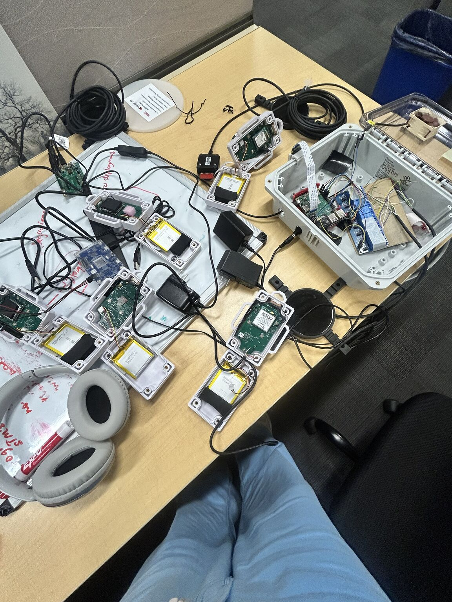

## Project Overview

As **Electronic Engineering Lead** of the Autonomous Robotics Club at Purdue University, I designed and built a robotic hand capable of playing the piano wirelessly. The project spans two hardware generations and involves full-stack embedded systems work — from firmware to custom PCB design.

## What I Built

- **Version 1:** Programmed an ESP32 microcontroller in MicroPython (Thonny IDE) to drive servo and stepper motors controlling each finger.
- **PID Control System:** Implemented a PID feedback loop with rotary encoder input for precise finger positioning, achieving **<10% position error**.
- **Firmware Optimization:** Tuned motor firmware to extract maximum available torque from each actuator.
- **Multi-layer PCB (KiCAD):** Designed a custom board to handle servo and stepper motor control signals cleanly.
- **Power System:** Designed a buck converter + PMOS switch circuit for long-duration plug-and-play operation.
- **BLE Wireless Control:** Integrated Bluetooth Low Energy for wireless piano sheet playback.
- **Version 2 (in progress):** Migrating the architecture to STM32 for greater processing power and peripheral flexibility.

## Tech Stack

- **Microcontrollers:** ESP32 (v1), STM32 (v2)
- **Languages:** MicroPython, C
- **Tools:** KiCAD PCB Design, Thonny IDE
- **Actuators:** Servo motors, stepper motors
- **Sensors:** Rotary encoders

## Role

Electronic Engineering Lead — Autonomous Robotics Club, Purdue University
**August 2024 – Present**
