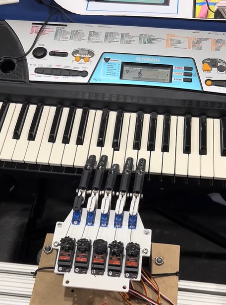

## Overview

**Embedded Systems Intern @ Wavelogix, Inc.** — West Lafayette, IN
**May 2026 – July 2026**

At Wavelogix I owned end-to-end firmware development for a production IoT hardware platform built around Quectel 4G/GNSS modules, debugged serial and Docker mapping issues, and built internal tooling to accelerate manufacturing.

## Key Contributions

### GNSS Firmware (C)
- Deployed production C-based GNSS firmware on Quectel 4G modules using a **Finite State Machine (FSM)** for GNSS state management, including cell connection and power management.
- Empirically tuned GPS acquisition delays to maintain a consistent **sub-2.0 HDOP** (Horizontal Dilution of Precision) across test environments.
- Debugged serial communication errors and Docker device-mapping failures caused by third-party API limitations.

### STM32 Telemetry Fix + Unit Tests
- Resolved a telemetry bug in STM32 firmware initialization logic.
- Wrote automated unit tests to guard against regressions.

### Automated HIL Test Bench (Python)
- Architected a **Hardware-in-the-Loop (HIL) test bench** using a Raspberry Pi and Nordic PPK2 power profiler.
- Automated firmware validation, power profiling, and current consumption tracking for production sign-off.

### Manufacturing Desktop GUI (Python)
- Developed a full-stack **Python GUI desktop application** to automate internal manufacturing workflows, including device provisioning.

## Tools & Tech

`C` · `STM32` · `Quectel 4G` · `GNSS/GPS` · `Finite State Machines` · `Segger J-Link` · `RTT` · `Raspberry Pi` · `Nordic PPK2` · `Python` · `Docker` · `Linux`
