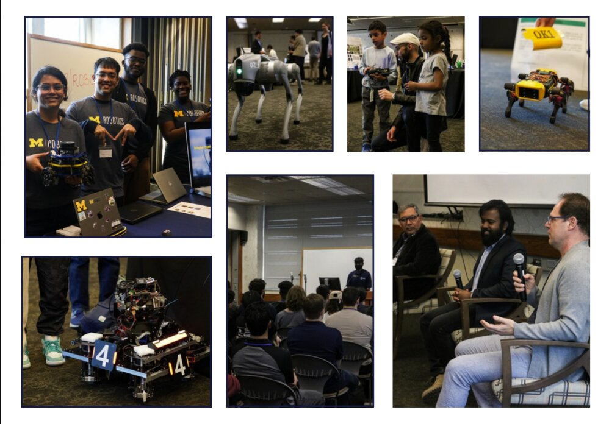

## Overview

**Undergraduate Researcher — SoCET Design Flow: Clock Optimization**
Purdue University | **August 2026 – Present**

Working within the SoCET (System-on-Chip Enabling Technologies) research group, I am contributing to the physical design of the **AFTx08** SoC — specifically Clock Tree Synthesis (CTS), a critical step in ensuring all sequential logic across the chip fires reliably at the same instant.

## What I'm Doing

### H-Tree Global Clock Distribution
- Implemented an **H-tree-based global clock distribution network** in Synopsys Fusion Compiler using Tcl scripting.
- Configured clock buffers and routing rules to **minimize clock skew** across a multi-source clock domain.

### Multi-Source CTS
- Navigated the complexity of multiple independent clock sources converging in a single physical design.
- Iterated on buffer sizing and placement to balance drive strength vs. area overhead.

## Tools & Tech

`Synopsys Fusion Compiler` · `Tcl` · `Clock Tree Synthesis (CTS)` · `Digital IC Design` · `SoC Physical Design` · `Verilog`

## Why It Matters

Clock skew is one of the most subtle and destructive bugs in digital hardware — a few picoseconds of mismatch can cause setup/hold violations at GHz frequencies. This research gives me hands-on experience with the professional EDA toolchains used to tape out real silicon.
