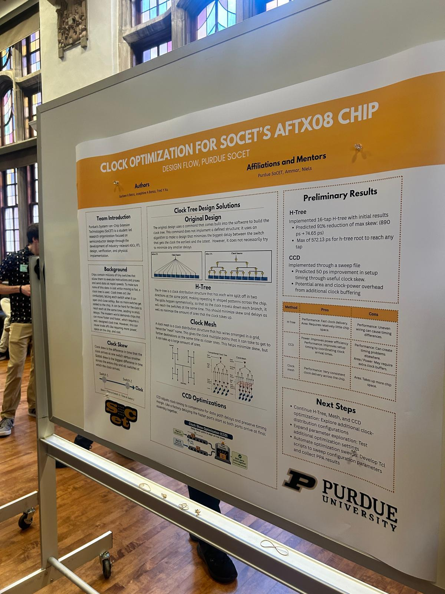

## Overview

**Electrical Engineer — Humanoid Robotics Club, Purdue University**
**January 2025 – Present**

As part of the Electrical Engineering team for Purdue's Humanoid Robotics Club, I took ownership of the PCB design for the full-leg actuation system — the hardware backbone enabling the robot to walk, balance, and move.

## What I Did

### PCB Design (Altium Designer)
- Led the full-leg actuation PCB layout and schematic design in **Altium Designer**.
- Coordinated power distribution, motor driver routing, and signal integrity for high-current actuator channels.
- Iterated on board revisions based on mechanical constraints and thermal performance.

### Hardware Testing & Validation
- Conducted hardware testing using **proprietary Unitree software** to characterize actuator response.
- Implemented and validated sensor integration across the actuation chain.
- Diagnosed signal and power issues through systematic bench testing.

## Tools & Tech

`Altium Designer` · `PCB Layout` · `Motor Drivers` · `Unitree SDK` · `Sensor Integration` · `Hardware Debugging`

## Context

Building a full humanoid leg demands extreme reliability — any PCB failure translates directly to a physical fall. This project pushed my skills in layout-for-reliability, high-current design, and iterative hardware validation.
